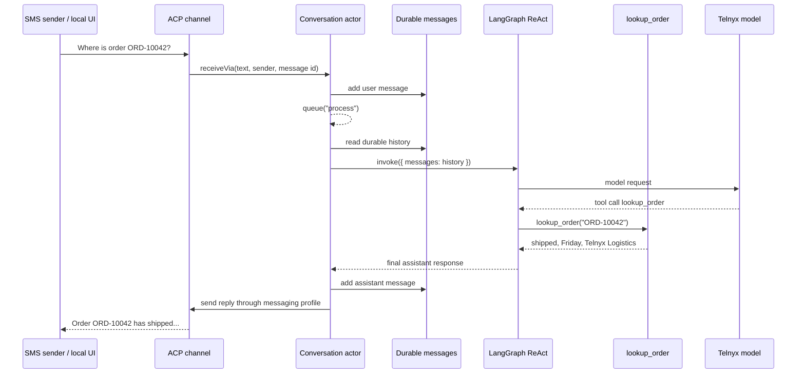

# Bring Your Framework ACP — Architecture

## What this project proves

The project has two independent framework cuts around one intentionally small
order-status scenario:

> “You already have a loop. Keep it.”

Pipecat owns the voice loop. LangGraph owns the text loop. Telnyx provides the
communications channels, model access, deployment/runtime, durable actor
boundary, and operational logs around those loops.

## System architecture

```mermaid
flowchart LR
  subgraph Channels[One Telnyx number, two channel attachments]
    Caller[Caller on phone]
    SMS[SMS sender]
    Num[Your Telnyx number]
    TeXML[TeXML application\nvoice webhook]
    Profile[Messaging profile\nSMS webhook]
    Caller --> Num
    SMS --> Num
    Num --> TeXML
    Num --> Profile
  end

  subgraph Pipecat[Cut 1 — Pipecat on Telnyx Edge]
    Edge[Telnyx Edge function]
    PBot[Existing Pipecat bot.py]
    Pipeline[Pipecat pipeline\ntransport → STT → LLM → TTS]
    TeXML --> Edge --> PBot --> Pipeline
    Pipeline --> Edge --> TeXML --> Caller
  end

  subgraph ACP[Cut 2 — LangGraph through ACP]
    EdgeWeb[Edge-hosted ACP web page\n/web]
    Webhook[ACP messaging webhook]
    Actor[Agent Runtime\nConversation actor]
    Receive[Conversation.receive()\nadd user message + queue process]
    Process[Conversation.process()\nread durable history]
    Graph[LangGraph ReAct\ncreateReactAgent]
    Model[Telnyx model endpoint\nGLM-5.3-Flash]
    Tool[lookup_order\ndeterministic demo data]
    Reply[Persist assistant reply\nsend SMS through profile]
    EdgeWeb --> Actor
    Profile --> Webhook --> Actor --> Receive --> Process --> Graph
    Graph --> Model
    Model --> Tool
    Tool --> Graph --> Reply --> Profile --> SMS
  end

  subgraph Control[Optional local recording helper only]
    Browser[Browser UI\nlocalhost:4173]
    Proxy[Node proxy\nRPC + native traces]
    Browser --> Proxy --> Actor
    Proxy -.-> Logs[telnyx-acp traces\nACP run/model/tool/delivery steps]
  end
```

## LangGraph request sequence



## What came from the official Pipecat repo

The directory `pipecat-edge/` is the cloned `team-telnyx/pipecat-edge`
reference project. Its framework files are not the ACP integration:

- `function/bot.py` is the Pipecat voice loop.
- `function/telnyx_stt.py` provides the Telnyx STT service.
- `function/telnyx_tts.py` provides the Telnyx TTS service.
- `function/func.py` provides the Edge/TeXML entrypoint.
- `pyproject.toml` and `func.toml` provide its Python packaging/runtime setup.

The official clone remains the reference copy. The deployed recording copy is
outside this project at `../bring-your-framework-pipecat/`; its only code-level
difference is the order-status prompt and greeting. The Pipecat pipeline was
not rewritten.

## What this project added

### LangGraph/ACP code

- `langgraph-acp/src/index.ts`: the `Agent` subclass and runtime boundary.
- `langgraph-acp/src/graph.ts`: the LangGraph ReAct graph and model client.
- `langgraph-acp/src/tools.ts`: the visible deterministic `lookup_order` tool.
- `langgraph-acp/src/conversation.ts`: durable state and final-reply helpers.
- `langgraph-acp/agent.json`: code-agent configuration and channel declaration.
- Tests for the tool and graph behavior.

The important glue is deliberately small:

```text
receive()
  → durable user message
  → queue("process")
  → read history
  → LangGraph invoke
  → durable assistant message
```

### Optional local demonstration UI

- `ui/index.html`: the recording control room.
- `ui/server.mjs`: local proxy that invokes the deployed actor and reads recent
  framework-level runtime events.

The UI is not part of the deployed agent and is not required for production.
It is a local browser client that calls the deployed persistent actor over its
Agent SDK RPC endpoint and runs `telnyx-acp traces` locally to present the
native run/model/tool/delivery steps in one screen. It also shows framework
logs as a detail fallback. The normal product/demo path can use
`telnyx-acp text` and `telnyx-acp traces` without the UI.

### Documentation and checks

- `README.md`: setup and project explanation.
- `DEMO_SCRIPT.md`: the eight-minute recording plan.
- `scripts/check-prereqs.sh`: local prerequisite checks.
- `scripts/verify-demo.sh`: project verification checks.
- `.gitignore`: excludes credentials, generated ACP files, and local runtime
  state.

## Account configuration

The final intended channel layout is:

```text
same Telnyx number
├── voice connection: TeXML application → Pipecat Edge function
└── messaging profile: ACP webhook → LangGraph Agent Runtime
```

This is why the first attempt looked like two numbers: ACP’s `phone` mode
expects to provision a Call Control voice application, while the Pipecat
number already had a TeXML voice connection. The corrected setup uses ACP’s
existing `messaging_profile:<id>` channel mode, preserving TeXML voice while
adding ACP SMS on the same number.

## Build process in plain language

1. Clone the official Pipecat sample so the existing framework loop is available
   and visibly unchanged.
2. Create a separate TypeScript project for the LangGraph cut.
3. Wrap LangGraph in the Agent SDK’s `Agent` class.
4. Put the order lookup behind one visible tool with deterministic data.
5. Add durable message history so the agent has a stateful conversation.
6. Deploy the code agent with `telnyx-acp`.
7. Attach ACP to an existing messaging profile on the same number instead of
   asking ACP to replace the Pipecat TeXML voice connection.
8. Add the local UI so a recording can show the conversation and event trail in
   one screen.
9. Validate the LangGraph code with typecheck/tests and validate the live path
   with an ACP invocation and native traces.

## What is live versus local

| Piece | Where it runs | Purpose |
|---|---|---|
| Official Pipecat source | Local repository | Reference and unchanged framework loop |
| Pipecat demo copy | Telnyx Edge | Live phone-call cut |
| LangGraph agent | Telnyx Agent Runtime via ACP | Live text/ACP cut |
| Edge ACP web page | Telnyx Edge at `/web` | Primary browser view for the deployed persistent actor |
| Control room | Optional helper on your laptop at `127.0.0.1:4173` | Fallback recording UI; not part of the agent |
| `lookup_order` data | Agent code | Deterministic demo fixture, not a production database |

## Honest limitations

- Pipecat and LangGraph are two separate framework cuts; this is not a parity
  benchmark.
- Native ACP traces show the run/model/tool/delivery steps; detailed model
  arguments and tool results remain framework-level logs.
- The number must be attached to both a TeXML voice application and a
  messaging profile; ACP should not replace the Pipecat voice connection.
- The ACP SDK/CLI surface is beta/pre-release, so the recording keeps CLI and
  screencast fallbacks.
