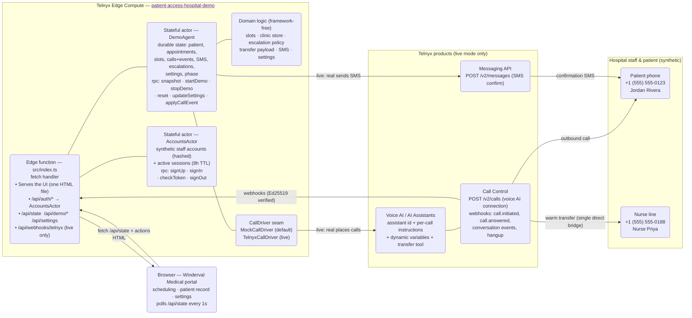
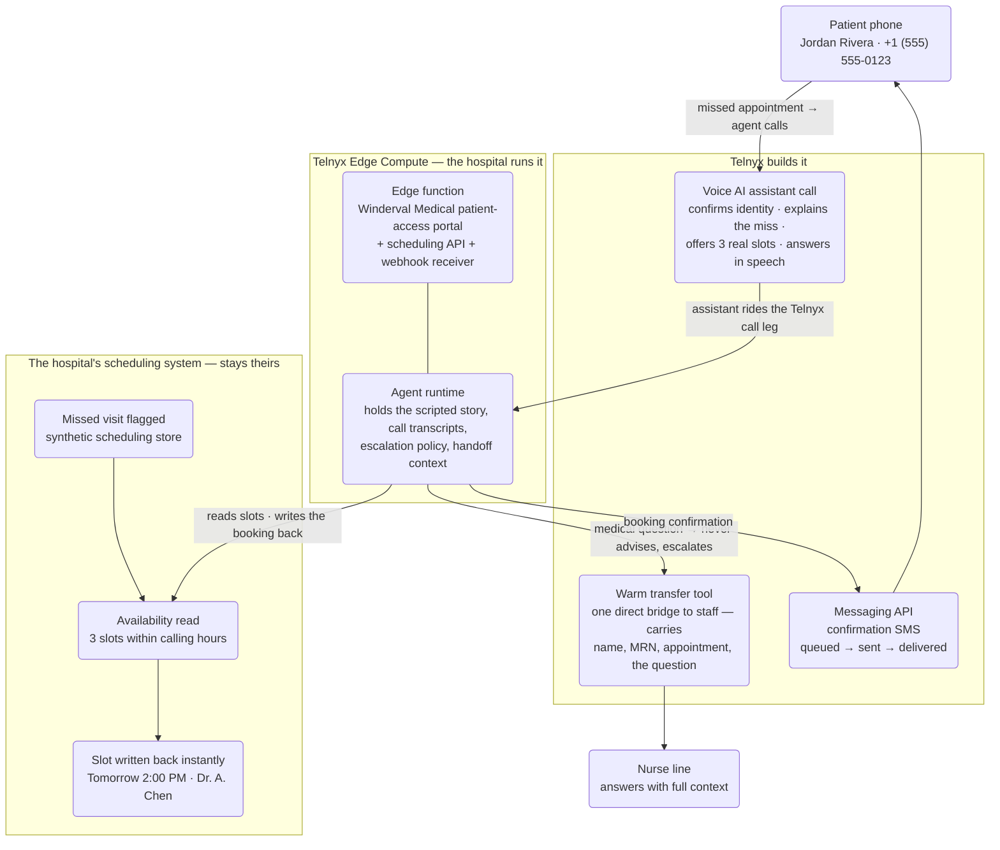

# Architecture — patient-access-hospital-demo

**One Edge Compute function. Two stateful actors (demo state + auth). One HTML file.** Mock mode by default; live mode is strictly opt-in.

## The shape

The app is a Telnyx Edge Compute umbrella project (`telnyx.toml`): a Node-container function that serves everything, plus one stateful actor that owns all demo state.

*Mock mode: everything above the Telnyx products runs exactly as shown, but the
transport is the MockCallDriver (scripted agent+patient dialogue) and the SMS
advances queued→sent→delivered in-process. Nothing external is ever called.*

## Layer by layer

| Layer | File(s) | Role |
|---|---|---|
| Edge function (HTTP) | `src/index.ts` | Fetch-handler router. Serves the UI at `/`, the JSON API (`/api/state`, `/api/demo/start|stop|reset`, `/api/settings`), and the Telnyx webhook receiver. Re-exports `DemoAgent` (required by the runtime). |
| Stateful actor | `src/demo/demoAgent.ts` | `DemoAgent extends Agent<Env, DemoState>` — the single source of truth for demo state, persisted via actor storage (survives restarts). Owns the clinic store, the call driver, and the demo driver. `@rpc()` methods are the only way in. |
| Auth actor | `src/demo/accountsActor.ts` | `AccountsActor` — the login gate: synthetic staff accounts (scrypt-hashed) and active sessions in durable actor state; `@rpc()` signUp / signIn / checkToken / signOut. Sessions are 8-hour HttpOnly cookies. |
| Demo orchestrator | `src/demo/demoDriver.ts` | The 14-beat scripted story (call → identify → explain → offer slots → choose → book → SMS → medication question → refuse → escalate → warm transfer → staff handoff), paced per beat, running inside the actor. Mode-agnostic: in live mode it places the real call and waits for webhook-driven end. |
| Domain logic | `src/domain/*` | Framework-free and fully unit-tested (28 tests): deterministic slot generation honoring calling hours, the mock clinic store (missed marking, booking write-back, double-book rejection), medical-question detection + the never-advise escalation policy + handoff context, the exact Telnyx transfer-tool payload, the SMS builder, zod settings validation. |
| Call seam | `src/call/*` | `CallDriver` interface with two adapters: `MockCallDriver` (default; simulated transport) and `TelnyxCallDriver` (real `POST /v2/calls` + webhooks). The domain never knows which one is running. |
| Edge bindings | `src/server/env.ts` | Mode parsing (env vars) + fail-closed live validation. Secrets (`TELNYX_API_KEY`, `TELNYX_PUBLIC_KEY`) come from the `env.SECRETS` binding, never from the repo. |
| UI | `src/ui.ts` | One self-contained HTML template (inline CSS + vanilla JS, no build step, no external requests). Polls `/api/state` every second while visible and re-renders sections. Rebrand by changing `BRAND_NAME` / `BRAND_ACCENT` in `telnyx.toml` + swapping the `LOGO SVG BLOCK`. |

## How Telnyx products are used

1. **Edge Compute** — the deployment target itself: `telnyx.toml` declares the
   function (`src/index.ts`), the `DemoAgent` actor type, the `TELNYX` binding,
   env vars, and the two secrets. `npm run demo` (→ `telnyx-edge dev`) runs the
   real Edge stack locally in Docker; `npm run ship` (→ `telnyx-edge ship`)
   deploys it to a public `*.telnyxcompute.com` URL.
2. **Voice AI (AI Assistants)** — the outbound call is placed through
   `POST https://api.telnyx.com/v2/calls` with `connection_id` (a voice-AI-enabled
   Call Control application) and an inline assistant config: `assistant.id` plus
   per-call `instructions`, `dynamic_variables` (patient name, missed-appointment
   summary, the actual generated slot options), and `tools`. The instructions carry
   the strict never-diagnose rule and the exact escalation line.
3. **Call Control** — the call lifecycle and the transfer: the assistant's
   built-in `transfer` tool performs a **single direct warm transfer** to the
   staff number (`targets: [{name, to: staffPhone}]`,
   `warm_transfer_instructions: …`). No conferences, no multiparty, no Contact
   Center. Webhooks from the Call Control application flow into the patient
   record timeline (Ed25519-signed when `TELNYX_PUBLIC_KEY` is configured).
4. **Messaging API** — the appointment confirmation SMS is built in
   `src/domain/sms.ts` from the booked appointment and sent in live mode via
   `POST /v2/messages`; the UI shows its queued→sent→delivered lifecycle. (Live
   SMS from a US toll-free number requires verification — 10DLC or TFV — before
   the carriers will deliver it.)

## Why this split

- **Mock-first** is a product requirement, not a shortcut: the demo must never
  touch anyone's phone by accident. The CallDriver seam means the same scripted
  story runs with zero Telnyx calls, and flipping to live changes one adapter.
- **The actor owns the state** so it survives restarts and hot reloads — demo
  day doesn't lose its place.
- **Auth lives in its own actor** — account records (salted+hashed) and
  sessions never mix with demo state, and the login gate keeps the portal
  closed by default.
- **The domain is pure** — every required behavior (missed state, slot
  selection, booking write-back, SMS, escalation policy, transfer payload,
  settings) is a unit test that runs in milliseconds.

---

## Sales view — the one-diagram story for AEs and FDEs

Paste into mermaid.live (dark theme matches the editor default):

The two things no other healthcare demo does: the agent reads and **writes
into the hospital's own scheduling system** (what it hears is what the
calendar shows), and a medical question is **handed to staff with complete
context** so nobody asks the patient twice. Everything else — the agent
runtime, the portal, the webhook receiver — is a single Edge Compute function
the hospital owns and reconfigures on screen.
